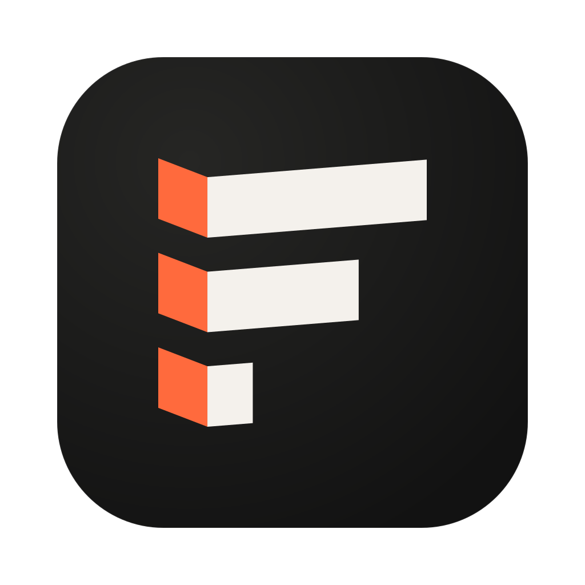
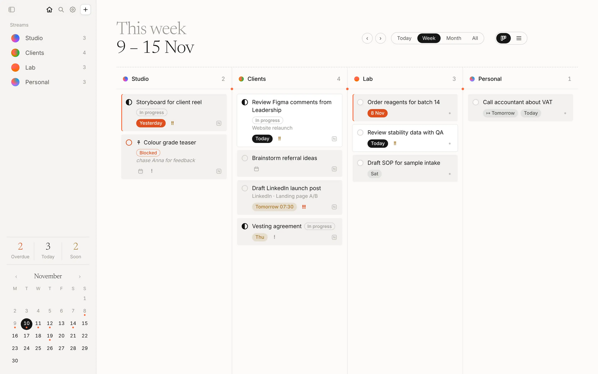

  

<h1 align="center">Fold</h1>

  <b>All your tasks from every app, in one calm list.</b> 
  Free. No account. Your tasks stay on your device.

  <a href="https://foldtasks.com"><b>foldtasks.com</b></a>
  &nbsp;·&nbsp;
  <a href="https://github.com/BeingJohannes/fold-release/releases/latest/download/Fold-mac-arm64.dmg">Mac</a>
  &nbsp;·&nbsp;
  <a href="https://github.com/BeingJohannes/fold-release/releases/latest/download/Fold-win-x64.exe">Windows</a>
  &nbsp;·&nbsp;
  <a href="https://github.com/BeingJohannes/fold-release/releases/latest/download/Fold-win-arm64.exe">Windows on ARM</a>
  &nbsp;·&nbsp;
  <a href="https://foldtasks.com/app/">Use it in your browser</a>

  <picture>
    <source media="(prefers-color-scheme: dark)" srcset="assets/week-dark.png">
    
  </picture>

Your tasks live in the apps other people chose: a client's Jira, your employer's Planner, two Notion workspaces, your own Todoist. Fold shows them together.

- **One list.** Everything assigned to you, from every app, with your meetings on a timeline above.
- **Nothing copied.** Fold reads your tasks where they are. No duplicates, nothing moved.
- **A stream for each company** or part of your life. Look at one, or all of them.
- **Tick things off at the source**, only where you switch it on, with undo. Fold never deletes anything.
- **Yours.** No account, and your tasks and sign-ins stay on your device.

**Works with** Notion · Jira · Microsoft Planner · Microsoft To Do · Asana · Linear · Todoist · Trello · GitHub · GitLab · Apple Reminders · Google, Outlook and iCloud calendars

## Download

| | |
| --- | --- |
| **Mac** (Apple silicon, M1 or later) | [Fold-mac-arm64.dmg](https://github.com/BeingJohannes/fold-release/releases/latest/download/Fold-mac-arm64.dmg) |
| **Windows 10 and 11** (most PCs) | [Fold-win-x64.exe](https://github.com/BeingJohannes/fold-release/releases/latest/download/Fold-win-x64.exe) |
| **Windows on ARM** (Snapdragon laptops) | [Fold-win-arm64.exe](https://github.com/BeingJohannes/fold-release/releases/latest/download/Fold-win-arm64.exe) |
| **Nothing to install** | [foldtasks.com/app](https://foldtasks.com/app/) |

These always give the newest version. On Windows, Fold then keeps itself up to date; on a Mac it tells you when there's a new one to download.

### The first time you open it

Fold is a beta and isn't signed by Apple or Microsoft yet, so your computer will ask once:

- **Mac:** System Settings → Privacy & Security → **Open Anyway**, then choose **Always Allow** for the Keychain.
- **Windows:** **More info** → **Run anyway**. If it still won't open, right-click the file → Properties → tick **Unblock**.

## Free, with Pro if you want more

Fold is free with every app and every view, and up to 3 streams. **Fold Pro** adds unlimited streams, encrypted sync between your devices and AI assistants: £4 a month, £36 a year, or £25 once as a founding licence.

## Good to know

- **Privacy:** [foldtasks.com/privacy](https://foldtasks.com/privacy). Fold talks to your apps directly from your device.
- **Something wrong, or an app you'd like added?** In Fold, open Help → Report a problem, or email [hello@foldtasks.com](mailto:hello@foldtasks.com).
- **What's new:** [all versions](https://github.com/BeingJohannes/fold-release/releases).

Made by <a href="https://mmhmm.studio/labs">MMHMM Labs</a>

