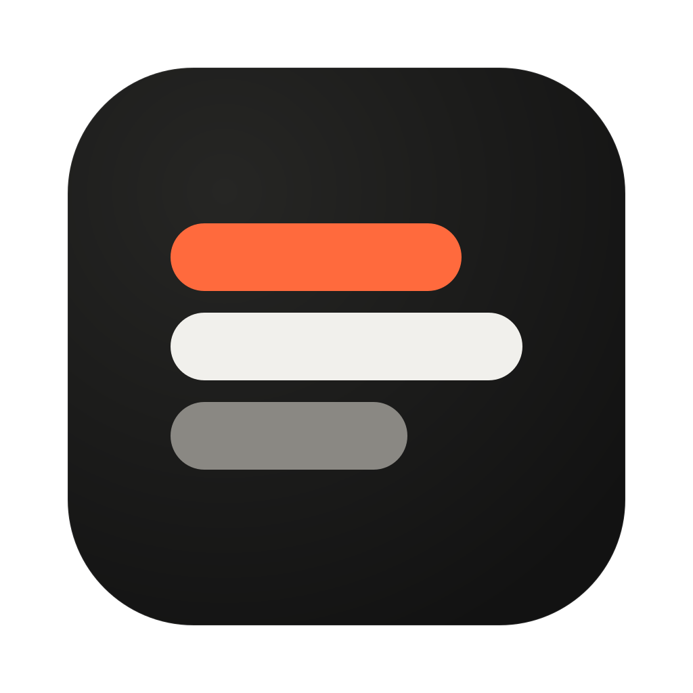
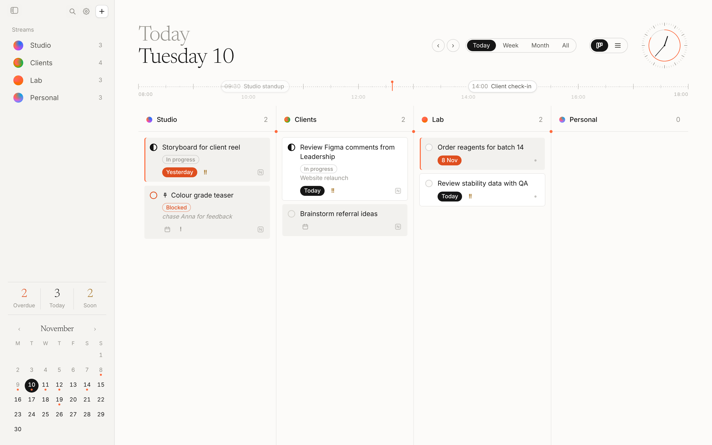

  

<h1 align="center">Fold</h1>

  All your tasks, one calm list. 
  Free, and it stays on your computer.

  <a href="https://foldtasks.com"><b>foldtasks.com</b></a>
  &nbsp;·&nbsp;
  <a href="https://github.com/BeingJohannes/fold-release/releases/latest/download/Fold-mac-arm64.dmg">Mac</a>
  &nbsp;·&nbsp;
  <a href="https://github.com/BeingJohannes/fold-release/releases/latest/download/Fold-win-x64.exe">Windows</a>
  &nbsp;·&nbsp;
  <a href="https://github.com/BeingJohannes/fold-release/releases/latest/download/Fold-win-arm64.exe">Windows on ARM</a>
  &nbsp;·&nbsp;
  <a href="https://foldtasks.com/app/">Browser</a>

  <picture>
    <source media="(prefers-color-scheme: dark)" srcset="assets/today-dark.png">
    
  </picture>

Fold isn't signed by Apple or Microsoft yet, so the first time you open it:

- **Mac:** System Settings → Privacy & Security → **Open Anyway**, and choose **Always Allow** for the Keychain.
- **Windows:** More info → **Run anyway**.

[All versions](https://github.com/BeingJohannes/fold-release/releases)
